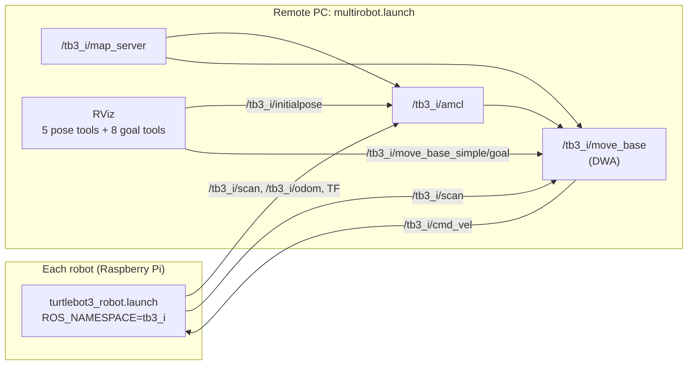
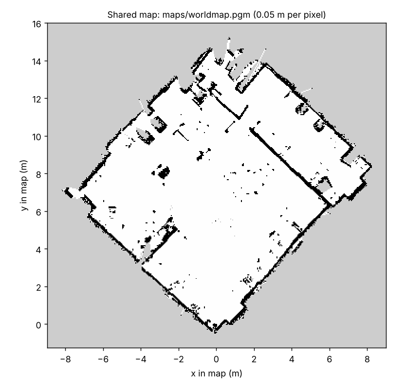

# TurtleBot3 Multi-Robot Navigation (ROS Noetic)

Launch files, per-robot navigation parameters, a shared map and an RViz layout for running **five TurtleBot3 Burger robots at once**. Everything is driven from one remote PC. Each robot lives in its own namespace (`tb3_0` to `tb3_4`) with its own map server, Adaptive Monte Carlo Localisation (AMCL) and `move_base`, and all of them share one map. One RViz window has a pose-estimate tool and a goal tool for every robot.

This package is the navigation layer for the formation controllers in [multi_robot_formation](https://github.com/adithya2204/multi_robot_formation). It was run on five real robots in a lab, not in simulation.

| Repository | Role |
|---|---|
| [turtlebot3-multirobot-setup-guide](https://github.com/adithya2204/turtlebot3-multirobot-setup-guide) | Step-by-step setup: Raspberry Pi, networking, SLAM, multi-robot bringup |
| **turtlebot3_multirobot_navigation** (this repo) | Per-robot localisation and navigation on a shared map |
| [multi_robot_formation](https://github.com/adithya2204/multi_robot_formation) | Triangle, square and pentagon formation controllers |

---

## How it fits together



`multirobot.launch` includes the five per-robot files `multi_<i>_turtlebot3_navigation.launch`. Each one wraps its nodes in `<group ns="tb3_i">` and also starts `turtlebot3_remote.launch` for that robot's `robot_state_publisher`. All TF frames are prefixed (`tb3_i/odom`, `tb3_i/base_footprint`, `tb3_i/base_scan`), so the robots don't collide on the TF tree.

---

## Per-robot setup

| Robot | Start pose in `map` (x, y, yaw) | Parameters |
|---|---|---|
| `tb3_0` | (−6.8, −0.512, 1.51) | `multi_param/multi_param0/` |
| `tb3_1` | (−5.0, −0.512, 1.51) | `multi_param/multi_param1/` |
| `tb3_2` | (−3.2, −0.512, 1.51) | `multi_param/multi_param2/` |
| `tb3_3` | (−1.4, −0.512, 1.51) | `multi_param/multi_param3/` |
| `tb3_4` | (0.4, −0.512, 1.51) | `multi_param/multi_param4/` |

The robots start in a row 1.8 m apart, all facing +y. The start poses are fixed with `value=` in each launch file, so to move them, edit `initial_pose_x/y/a` there rather than passing arguments.

> **Set the poses in RViz.** These start poses fall just outside the area covered by the included `worldmap` (below its lower corner), so they are only an initial guess. Before sending goals, set each robot's real pose with its *2D Pose Estimate* tool.

The five parameter folders are the same apart from the robot's frame and topic names:

| Component | Settings |
|---|---|
| AMCL | 500–3000 particles, likelihood-field laser model (3.5 m range, 180 beams), differential-drive odometry model |
| Local planner | Dynamic Window Approach (DWA) via `dwa_local_planner`, $\lvert v\rvert \le 0.22$ m/s, $\lvert\omega\rvert \le 2.75$ rad/s, 1.5 s forward simulation at 10 Hz |
| Goal tolerance | 0.15 m and 0.15 rad |
| Global costmap | static map + obstacle layer + inflation (1.0 m), 0.075 m cells |
| Local costmap | 3 m × 3 m rolling window in `map`, obstacle layer + inflation (0.75 m) |
| Footprint | TurtleBot3 Burger rectangle, from (−0.105, −0.105) to (0.041, 0.105) m |

The launch files load only `local_costmap_params`, `global_costmap_params`, `move_base_params` and `dwa_local_planner_params_burger`. The `base_local_planner_params` and `costmap_common_params_burger` files in each folder are not loaded and are kept for reference only.

---

## Requirements

- Ubuntu 20.04 and ROS Noetic on the remote PC and on every robot
- TurtleBot3 packages (`turtlebot3`, `turtlebot3_bringup`) and the navigation stack (`amcl`, `map_server`, `move_base`, `dwa_local_planner`)
- Five TurtleBot3 Burger robots (Raspberry Pi, LDS-01 LiDAR) on the same network as the PC

The full machine setup is in the [setup guide](https://github.com/adithya2204/turtlebot3-multirobot-setup-guide).

## Installation

```bash
cd ~/catkin_ws/src
git clone https://github.com/adithya2204/turtlebot3_multirobot_navigation.git
cd ~/catkin_ws && catkin_make
source devel/setup.bash
```

The included map (`maps/worldmap.pgm`, `maps/worldmap.yaml`) is the lab where the robots were tested:



The map is 19.2 m × 30.4 m at 0.05 m per pixel, with its origin at (−10, −10). To use your own space, build a map with `turtlebot3_slam` and save it under the same names in `maps/`, or pass `map_file:=/path/to/map.yaml` to `multirobot.launch`.

## Usage

1. **PC:** start the ROS master.
   ```bash
   roscore
   ```
2. **Each robot** (replace `tb3_1` with that robot's name):
   ```bash
   ROS_NAMESPACE=tb3_1 roslaunch turtlebot3_bringup turtlebot3_robot.launch \
       multi_robot_name:="tb3_1" set_lidar_frame_id:="tb3_1/base_scan"
   ```
3. **PC:** start navigation for all five robots and RViz.
   ```bash
   roslaunch turtlebot3_multirobot_navigation multirobot.launch
   ```
4. **RViz:** use the five *2D Pose Estimate* tools to set each robot's pose, then the first five *2D Nav Goal* tools to send each robot a goal. Goal tools 6, 7 and 8 publish `/triangle_center_goal`, `/square_center_goal` and `/pentagon_center_goal` for [multi_robot_formation](https://github.com/adithya2204/multi_robot_formation).

To run a single robot, launch its own file, for example `roslaunch turtlebot3_multirobot_navigation multi_0_turtlebot3_navigation.launch open_rviz:=true`.

---

## Package layout

```
turtlebot3_multirobot_navigation/
├── launch/
│   ├── multirobot.launch                       # all five robots + RViz
│   └── multi_<0-4>_turtlebot3_navigation.launch
├── multi_param/multi_param<0-4>/               # per-robot move_base / costmap / DWA settings
├── maps/worldmap.{pgm,yaml}                    # shared map (0.05 m/px)
├── rviz/multi_turtlebot3_navigation.rviz       # per-robot displays and tools
├── CMakeLists.txt
└── package.xml
```

## Acknowledgements

Built during a summer internship in the Systems and Control Lab, Department of Electrical Engineering, IIT Madras (July 2025). The per-robot launch structure follows the ROBOTIS TurtleBot3 navigation package.

**Author:** Adithya Pothula

## License

Apache License 2.0. See [LICENSE](LICENSE).
